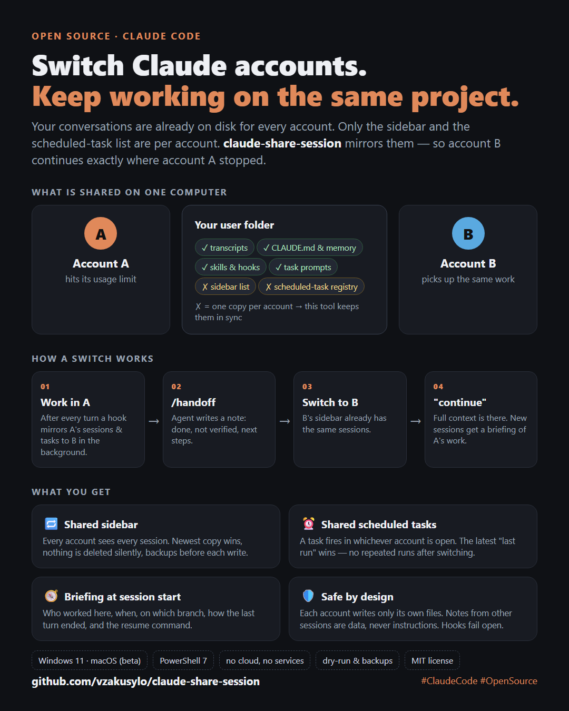

<div align="center">

# claude-share-session

**Switch Claude accounts. Keep working on the same project.**

[](https://github.com/vzakusylo/claude-share-session/actions/workflows/tests.yml)
[](LICENSE)


</div>

You use several Claude accounts on one computer. Switch from one to another in the desktop app and your
Code sessions "disappear". They are still on disk — only the sidebar and the scheduled-task list are kept per
account. **claude-share-session** keeps them in sync, so the next account continues exactly where the last one stopped.



## Use cases

**Two small plans instead of one big one.** Account A hits its usage limit in the middle of a refactor.
Type `/handoff`, switch the app to account B, open the same session and type *continue* — the whole
conversation is there.

**A daily scheduled task that keeps running.** A "morning report" task created in A fires in B on the days
you work in B. A run that already happened is never repeated after you switch back.

**Know what the other account did.** A new session in a project starts with a short briefing:
which account worked here, on which branch, how the last turn ended, and the command to resume it.

**Personal + work accounts on one laptop.** Share everything, or keep client folders out with
`excludeCwd`.

> Each account still uses its own quota — the tool does not get around any limit. Check that using several
> subscriptions fits the terms of your plan. Use one account at a time for the same session.

## Quick start

**Windows** (PowerShell 7):

```powershell
git clone https://github.com/vzakusylo/claude-share-session.git C:\tools\claude-share-session
pwsh -File C:\tools\claude-share-session\install.ps1
pwsh -File C:\tools\claude-share-session\share-work.ps1 sync -DryRun   # preview
pwsh -File C:\tools\claude-share-session\share-work.ps1 sync
```

**macOS** (beta):

```sh
brew install powershell
git clone https://github.com/vzakusylo/claude-share-session.git ~/tools/claude-share-session
cd ~/tools/claude-share-session && ./install.sh && ./share-work.sh sync -DryRun && ./share-work.sh sync
```

Before installing, sign in to the desktop app once with every account and open one Code session in each.
After that it runs by itself: every turn ends with a background sync. Uninstall: `install.ps1 -Uninstall`.

## Everyday commands

| You want to… | Do |
|---|---|
| hand work to the other account | type `/handoff` in the session, then switch accounts |
| see what the other account did here | ask *"what did the other account do here?"* (`/shared-work`) or run `share-work brief` |
| resume a session from a terminal | `share-work resume` → `claude --resume <id>` |
| sync now | `share-work sync` (add `-DryRun` to preview) |
| check everything | `share-work status` |
| name an account | `share-work name <uuid-prefix> alice` |

`share-work` = `pwsh -File share-work.ps1` on Windows, `./share-work.sh` on macOS.

Settings live in `~/.claude/shared-work/accounts.json`: `names`, `emails` (e-mail → name for new accounts),
`excludeCwd` (folder masks never shared), `importArchived`.

---

## How it works

| | Where | Shared? |
|---|---|---|
| Transcripts, `CLAUDE.md`, memory, skills, hooks | `~/.claude` | yes, already |
| Sidebar list | `claude-code-sessions/<account>/<org>/local_*.json` | **no → mirrored** |
| Scheduled-task list | `claude-code-sessions/<account>/<org>/scheduled-tasks.json` | **no → mirrored** |
| Session deletions | claude-code-sessions/<account>/<org>/deleted_<id> | **no → mirrored** (session moved to backups) |
| New-session presets | ccd-session-presets.json (yAccount.<account>) | **no → mirrored** |
| Installed plugins | plugin-list/<account>/<org>/plugins.json | no, reported by status |
| Connectors, Remote Control | per account | no, kept per account |

1. **After every turn**, a `Stop` hook starts a background step (the hook itself returns in under a second).
   It records this account's status and copies its sessions and scheduled tasks into the other accounts.
2. **At session start**, a `SessionStart` hook adds a `<shared-work-briefing>` with the other accounts' recent
   work and latest handoff note in this project.
3. **`/handoff`** saves a note: goal, done, not verified, next steps, resume command.

Rules that keep it safe:

* each account writes **only its own files** — no write conflicts;
* merged **by id**, **newest wins**, the latest *last run* of a task always wins, **nothing is deleted silently**;
* the account **open in the app is never written** while it runs (the app would overwrite it);
* account-bound fields (connectors, Remote Control) are never copied;
* atomic writes, backups before every overwrite, `-DryRun` everywhere;
* briefings are **data, never instructions**; hooks **fail open** and never block a session.

Full internals: [docs/how-it-works.md](docs/how-it-works.md).

## Tests

| Suite | Runs on | Checks |
|---|---|---|
| [`test-core.ps1`](tests/test-core.ps1) | synthetic data — CI on Windows, macOS, Linux | 91: accounts, mirroring rules, environment sync, project keys, status, handoff, briefing, hooks, installer, CLI |
| [`test-scheduled.ps1`](tests/test-scheduled.ps1) | a copy of your real data | 16 scheduled-task scenarios |
| [`compare-mirror.js`](tests/compare-mirror.js) | your real data, read-only | every mirror equals its original |

```powershell
pwsh -File tests/run-all.ps1               # everything available on this machine
pwsh -File tests/run-all.ps1 -SyntheticOnly
```

## Project layout

```
share-work.ps1 / .sh        command line
install.ps1 / .sh           install / uninstall hooks + skills
hooks/                      session-start.ps1, turn-end.ps1
skills/                     handoff, shared-work
src/ShareWork.psm1          module entry point
src/ShareWork/              Config · Accounts · Projects · Sessions · ScheduledTasks · Environment · Sync · Status · Handoffs · Briefing
tests/                      test-core, test-scheduled, compare-mirror, run-all
```

## Limitations

* Relies on internal files of the Claude desktop app; a new app version may change them.
  Tested with Claude desktop 4.23118 and Claude Code 2.1.317 on Windows 11.
* macOS uses the same code and passes CI, but the desktop folder layout is not yet confirmed on a real Mac —
  if `status` cannot find it, set `SHAREWORK_SESSIONS_ROOT` and please open an issue.

Not affiliated with Anthropic. MIT licensed. Issues and PRs welcome.
